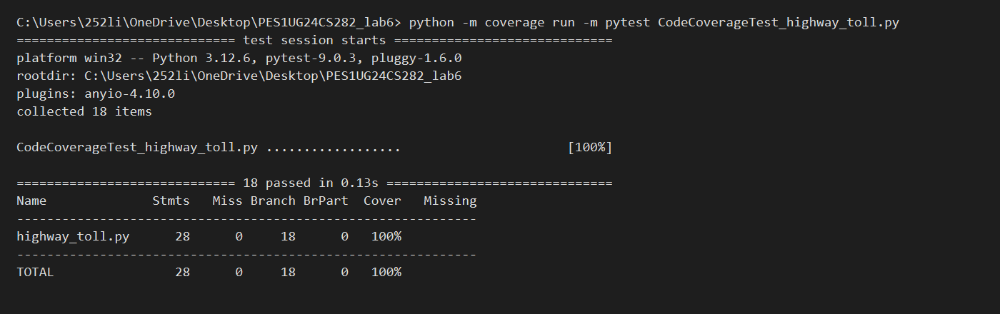
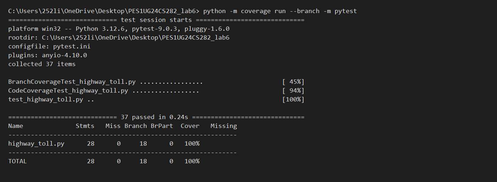

# Highway Toll Calculator

## Lab Information

- **Lab:** Lab 6: Code and Branch Coverage Analysis
- **Name:** M Likhith Reddy
- **SRN:** PES1UG24CS282

## Project Description

The Highway Toll Calculator is a Python application that calculates toll charges based on:

- Number of vehicle axles
- Peak and non-peak hours
- FASTag availability
- Emergency vehicle exemptions
- Monthly pass recommendations

The application is implemented in `highway_toll.py`.

## Implementation and Testing

The starter tests are in `test_highway_toll.py`.

### Code Coverage Tests

`CodeCoverageTest_highway_toll.py` contains 18 tests for comprehensive line/code coverage. All 18 tests passed and the application achieved 100% line coverage.

### Branch Coverage Tests

`BranchCoverageTest_highway_toll.py` contains targeted tests for branch coverage. It is part of the combined suite of 37 passing tests, which achieved 100% application branch coverage.

## Final Results

| Metric | Initial | Final |
|---|---:|---:|
| Application Line Coverage | 46% | 100% |
| Application Branch Coverage | 39% | 100% |
| Tests Passed | 2 | 37 |

Additional verification:

- Uncovered statements: 0
- Partial branches: 0
- Application file `highway_toll.py` remained unchanged.

## Git Commits

1. `edb4a4e` - test: add test cases for code coverage
2. `92ba025` - test: add test cases for branch coverage

## Coverage Screenshots

### Code Coverage Terminal Output

### Branch Coverage Terminal Output

